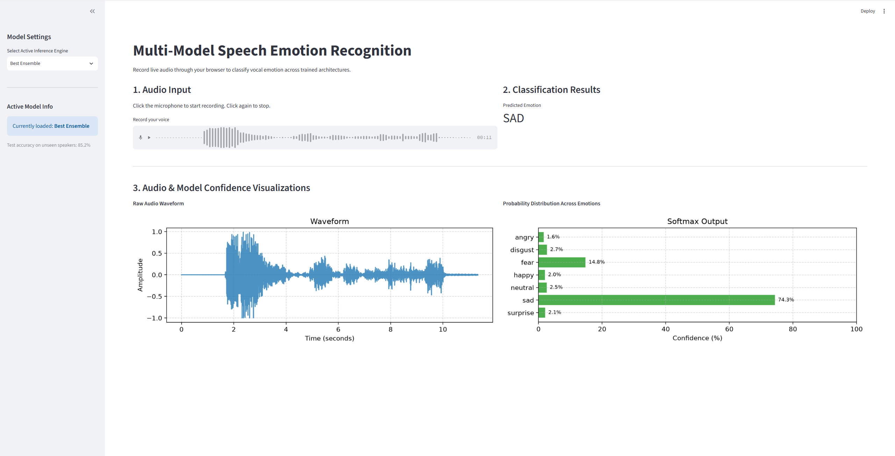
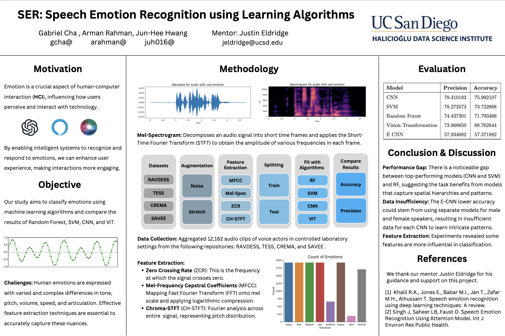
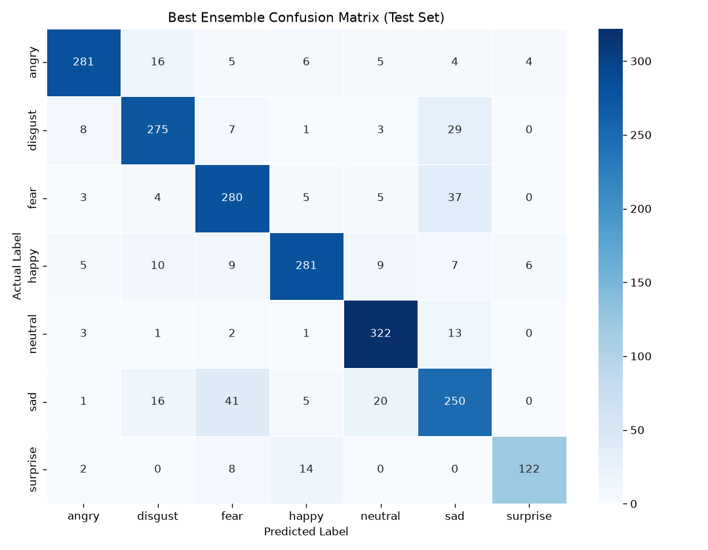

# Multi-Model Speech Emotion Recognition (SER)

An end-to-end audio processing and deep learning pipeline designed to classify human emotion from raw speech. This project features multiple architectures—ranging from traditional machine learning baselines to a fine-tuned Vision Transformer and a fine-tuned WavLM speech transformer—and includes a live, browser-based inference application.

**Best result: 85.2% accuracy (85.4% macro F1) across 7 emotions, on 19 speakers no model heard during training.**




This project aims to classify human emotions from speech using machine learning models. Initially developed as part of the Halıcıoğlu Data Science Institute Undergraduate Research Scholarship, this project has been developed further through enhanced data and finetuned models.

In its latest iteration, the evaluation was rebuilt after a data leak was found that had inflated earlier scores (see [Evaluation](#evaluation)). Every model was then retrained on a speaker-independent split, and a pre-trained speech transformer (WavLM) combined in a validation-tuned ensemble raised accuracy back to 85%, this time on unseen speakers.

## Project Overview

Unlike generic audio classifiers, this project explores the acoustic properties of human emotion through multiple specialized lenses. Raw audio waveforms are turned into 1D feature arrays (MFCCs and their deltas, log-mel energies, pitch, spectral shape) and 2D visual representations (Mel spectrograms), or fed directly to a pre-trained speech transformer. The system leverages these diverse architectures to identify emotional markers across four major datasets (RAVDESS, TESS, CREMA-D, SAVEE).

### Datasets

| Dataset | Recordings | Speakers | Emotions | Notes |
| --- | --- | --- | --- | --- |
| [CREMA-D](https://www.kaggle.com/datasets/ejlok1/cremad) | 7,442 | 91 (male and female) | 6 (no surprise) | Largest dataset: 12 sentences, varied speakers |
| [RAVDESS](https://www.kaggle.com/datasets/uwrfkaggler/ravdess-emotional-speech-audio) | 1,440 | 24 (12 male, 12 female) | 7 (`calm` merged into `neutral`) | Professional actors, two sentences |
| [TESS](https://www.kaggle.com/datasets/ejlok1/toronto-emotional-speech-set-tess) | 2,800 | 2 (female) | 7 | Single words in a carrier phrase |
| [SAVEE](https://www.kaggle.com/datasets/ejlok1/surrey-audiovisual-expressed-emotion-savee) | 480 | 4 (male) | 7 | Smallest dataset |
| **Total** | **12,162** | **121** | **7** | angry, disgust, fear, happy, neutral, sad, surprise |

Counts are after removing duplicate files: the Kaggle archives contain RAVDESS and TESS twice.

### Model Performance & Analysis

Test accuracy on **2,126 recordings from 19 speakers that no model saw in training** (speaker-independent split, see [Evaluation](#honest-evaluation)). Every number comes from `results/<model>.json`, written by the training scripts.

| Model | Test accuracy | Macro F1 | CREMA-D | RAVDESS | SAVEE | TESS |
| --- | --- | --- | --- | --- | --- | --- |
| **Best Ensemble** (WavLM + ViT, validation-weighted) | **85.2%** | **85.4%** | 78.6% | 84.2% | 65.0% | 99.0% |
| WavLM-Base+ (4 s window) | 81.8% | 82.1% | 75.0% | 86.2% | 64.2% | 93.6% |
| WavLM-Large (4 s window) | 81.0% | 79.8% | 77.1% | 81.2% | 67.5% | 89.1% |
| WavLM-Base+ (2.5 s window) | 79.1% | 80.0% | 72.2% | 80.8% | 62.5% | 91.7% |
| Fine-Tuned Vision Transformer (ViT) | 64.8% | 66.3% | 58.6% | 60.0% | 36.7% | 80.6% |
| Hierarchical Ensemble CNN | 55.4% | 55.7% | 50.1% | 50.8% | 27.5% | 69.7% |
| SVM Baseline | 53.8% | 52.3% | 52.1% | 55.4% | 25.8% | 60.7% |
| Stacked CNN | 52.9% | 53.1% | 51.4% | 49.6% | 25.0% | 61.0% |
| 1D CNN | 49.8% | 48.7% | 44.0% | 43.3% | 21.7% | 65.7% |
| Random Forest Baseline | 43.7% | 42.5% | 48.7% | 44.6% | 13.3% | 41.0% |

Chance level is 14.3% (1 in 7).

* **Best Ensemble:** a weighted average of five models' probabilities: WavLM-Large 0.35, ViT 0.30, and three WavLM-Base+ runs 0.35 combined. Weights were chosen on the validation split (85.4%) and the test set was scored once. This is the model the app opens on.
* **WavLM:** a transformer pre-trained on 94k hours of raw speech, fine-tuned here end to end. It is the biggest single jump (+14 points over the ViT). Feeding it the whole silence-trimmed utterance (up to 4 s) instead of a fixed 2.5 s cut added another 2.7 points. WavLM-Large is the best single model on validation (81.2%) and on the two hardest datasets.
* **Vision Transformer:** treats the Mel spectrogram as an image. Weaker alone, but it makes different mistakes from WavLM, which is why the ensemble gives it a large weight.
* **1D models (RF, SVM, CNNs):** limited by hand-crafted features. Adding standard deviations over time, log-mel energies, MFCC deltas and pitch (550 features instead of 162) improved every one of them, from +1.8 points (Random Forest) to +8.2 (Hierarchical Ensemble CNN). The SVM gained 22 points, mostly from re-tuning its hyperparameters with speaker-grouped cross-validation.
* **Where errors remain:** `sad` is the hardest emotion (often heard as `neutral`). SAVEE is the weakest dataset: its test set is one male speaker (120 clips), whose `surprise` is mostly heard as `fear`.



## Evaluation

### Evaluation protocol

* **Speaker-independent split.** Whole speakers are assigned to train, validation or test (about 70/15/15) within each dataset and sex: 84 / 19 / 19 speakers. No voice in the test set is heard during training. TESS has only two speakers, so one is used for training and the other is split between validation and test.
* **Validation for every decision.** Early stopping, best-epoch selection, the feature set, SVM hyperparameters and ensemble weights are all chosen on the validation split. The test split is scored once per model.
* **Augmentation only on training data.** Noise, time stretch, shift and pitch-shift copies are made for training recordings only; validation and test stay untouched.

### The data leak this replaced

Earlier versions of this project reported 74–86% accuracy (Random Forest 86%, Stacked CNN 82%, Hierarchical Ensemble CNN 81%, ViT 78%). Those scores were inflated by three problems:

1. **Duplicate files.** 4,240 of 16,402 recordings (26%) were byte-identical copies from nested folders in the Kaggle archives.
2. **Augmenting before splitting.** Each file became 5 feature rows *before* a random row-level split, so augmented copies of test clips sat in the training set. 99.8% of test rows had a copy of their recording in training.
3. **Shared speakers.** Every test speaker was also a training speaker.

A controlled experiment shows the size of the effect: the same features and the same Random Forest score **81.1%** with a random row split but **46.2%** with speakers held out. The full analysis is in Part 2 of [`notebooks/exploration.ipynb`](notebooks/exploration.ipynb).

## Architecture & Data Flow

```text
                          +-------------------------+
                          |  Raw Audio (.wav)       |
                          |  (Variable Length)      |
                          +------------+------------+
                                       |
         +-----------------------------+-----------------------------+
         |                             |                             |
+--------v-------------+   +-----------v----------+   +--------------v-------+
| 1D Feature Extractor |   | 2D Visual Extractor  |   | Raw Waveform         |
| (550-dim: MFCC +     |   | (Mel Spectrogram     |   | (16 kHz, silence-    |
|  deltas, log-mel,    |   |  image, 224x224)     |   |  trimmed, up to 4 s) |
|  pitch, ZCR, RMS)    |   |                      |   |                      |
+--------+-------------+   +-----------+----------+   +--------------+-------+
         |                             |                             |
+--------v-------------+   +-----------v----------+   +--------------v-------+
| ML Models / 1D CNNs  |   | Vision Transformer   |   | WavLM Transformer    |
| (RF, SVM, 1D CNN,    |   | (ViT Patch16-224)    |   | (Base+ and Large)    |
|  Stacked, Ensemble)  |   |                      |   |                      |
+--------+-------------+   +-----------+----------+   +--------------+-------+
         |                             |                             |
         |                             +--------------+--------------+
         |                                            |
         |                               +------------v------------+
         |                               | Best Ensemble           |
         |                               | (val-weighted average)  |
         |                               +------------+------------+
         |                                            |
         +----------------------+---------------------+
                                |
                    +-----------v-----------+
                    | Output Distribution   |
                    | (7 Emotion Classes)   |
                    +-----------------------+
```

### 1. Hierarchical Ensemble Routing

To address acoustic differences in biological sex, the `Ensemble CNN` utilizes a specialized routing architecture:
* **Gender Router:** A binary 1D CNN first evaluates the vocal profile to determine if the speaker is Male or Female (95.3% accurate on unseen speakers).
* **Sub-Models:** The feature tensor is dynamically routed to either the `Male Emotion Model` or `Female Emotion Model`, which are independently trained on sex-specific subsets of the data to reduce cross-gender acoustic confusion.

### 2. Vision Transformer (ViT) Track

To benchmark custom 1D convolutions against state-of-the-art spatial attention:
* **Data Transformation:** Audio is converted into 128-band Mel spectrograms, converted to decibels, scaled to 0-255 and resized to $224 \times 224$. Images are stored as a single channel and repeated to 3 channels, normalized the way the pre-trained ViT expects.
* **Fine-Tuning:** The `google/vit-base-patch16-224` backbone is utilized. The 1000-class ImageNet head is replaced with a custom 7-class dense layer, allowing the self-attention mechanism to find visual patterns in the acoustic frequency space. SpecAugment (randomly masked time and frequency bands), label smoothing and weight decay keep it from memorizing the training set.

### 3. WavLM Track

To learn emotion directly from the waveform instead of from hand-designed features:
* **Input:** Each recording is resampled to 16 kHz, trimmed of leading and trailing silence, and kept whole up to 4 s, so long RAVDESS and SAVEE sentences are no longer cut off.
* **Fine-Tuning:** `microsoft/wavlm-base-plus` (95M parameters) and `microsoft/wavlm-large` (316M) get a 7-class head on a learned weighted sum of all transformer layers (emotion cues live mostly in the middle layers). Training uses gain, noise and time-shift augmentation, learning-rate warmup, gradient clipping and full fp32 precision; without warmup and fp32, some runs collapsed early in training.

### 4. Best Ensemble

* **Combination:** A weighted average of the predicted probabilities of several healthy WavLM runs and the ViT.
* **Weight selection:** Greedy forward selection on the validation split repeatedly adds the model that most improves the running average. Runs that collapsed during training are excluded.

### 5. Live Application Architecture

* **State Management:** The Streamlit interface caches model weights, scalers, and encoders (`@st.cache_resource`, on the GPU for the neural networks) to ensure instant responsiveness without reloading massive models on every click.
* **Matching the Training Input:** Variable-length microphone recordings are cut into the same windows the models were trained on (2.5 s windows for the 1D models, the ViT and the 2.5 s WavLM; silence-trimmed windows of up to 4 s for the 4 s WavLM runs), each window is classified, and the probabilities are averaged. Training and the app share one feature module (`src/features.py`), so their inputs cannot drift apart.
* **Model Selection:** The sidebar lists every trained model, sorted by test accuracy, and opens on the best one (currently the Best Ensemble).

## Repository Structure

```text
Speech-Emotion-Recognition/
├── .gitignore               # Shields datasets, tensors, weights, and logs
├── requirements.txt         # Dependency and CUDA PyTorch locks
├── README.md                # Project documentation
├── saved_models/            # Trained weights are generated locally (see Getting Started)
│   ├── ensemble_best_weights.json # Best Ensemble members and weights
│   ├── rf_params.json / svm_params.json # Tuned baseline hyperparameters
│   └── <run>_config/        # Architecture config saved with each WavLM run
├── images/                  # Confusion matrices and training curves
├── notebooks/
│   ├── exploration.ipynb    # Original exploration, the data leak analysis, and the corrected results
│   └── monitor_training.ipynb # Live view of training runs from logs/
├── src/                     # Core Processing Modules
│   ├── config.py            # Paths, class list, audio window, and split settings
│   ├── ingestion.py         # KaggleHub downloader, de-duplication, and speaker-level split
│   ├── augmentations.py     # Noise, stretch, pitch, and shift tools
│   ├── features.py          # Feature code shared by training and the app
│   ├── extraction_1d.py     # Parallelized 1D feature pipeline
│   ├── extraction_vit.py    # Mel spectrogram image pipeline
│   ├── extraction_wave.py   # Waveform pipeline for WavLM
│   ├── data.py              # Split loading for the 1D models
│   ├── training.py          # Shared PyTorch training loop
│   ├── gpu_augmentations.py # SpecAugment and waveform augmentation
│   └── evaluation.py        # Test metrics, confusion matrices, and training curves
├── models/                  # PyTorch Architectural Blueprints
│   ├── cnn_1d.py            
│   ├── cnn_stacked.py       
│   ├── cnn_ensemble.py      
│   ├── vit.py               # ViT builder (pre-trained or offline)
│   └── wavlm.py             # WavLM builder (pre-trained or offline)
├── scripts/                 # Standalone Execution Pipelines
│   ├── train_baselines.py   # RF and SVM with speaker-grouped GridSearchCV
│   ├── train_cnn_1d.py      
│   ├── train_cnn_stacked.py 
│   ├── train_ensemble.py    
│   ├── train_vit.py         
│   ├── train_wavlm.py       # WavLM fine-tuning (Base+ or Large)
│   ├── compare_features.py  # Feature set comparison on the validation split
│   ├── evaluate_fusion.py   # Exports ViT and WavLM probabilities for the ensemble
│   └── evaluate_ensemble.py # Validation-tuned Best Ensemble
├── tests/
│   └── test_smoke.py        # Label parsing, split, feature, and model shape tests
└── app/                     # Live Web Application
    ├── inference.py         # Dynamic tensor routing and prediction logic
    └── main.py              # Streamlit UI, visualizer, and state manager
```

## Getting Started

### 1. Prerequisites & Environment Setup

Clone the repository and install the dependencies. The project uses Python 3.14. Ensure you have an NVIDIA GPU with CUDA 13.2 support for hardware acceleration; `requirements.txt` pulls the matching PyTorch build. Fine-tuning WavLM-Large needs about 11 GB of GPU memory; the other models need about 6–7 GB.

```bash
git clone https://github.com/Junismyname/Speech-Emotion-Recognition.git
cd Speech-Emotion-Recognition

# Create a virtual environment
python -m venv venv
source venv/bin/activate  # On Windows: venv\Scripts\activate

# Install required dependencies
pip install -r requirements.txt
```

### 2. Dataset Setup & Preparation

Download the required datasets (RAVDESS, TESS, CREMA-D, SAVEE) and generate the unified metadata file. This script pulls directly from Kaggle, removes duplicate files, and assigns every speaker to the train, validation, or test split:

```bash
python src/ingestion.py
```

### 3. Feature Extraction

Process the raw `.wav` files into formats the models can understand.

For the Machine Learning and CNN models (generates `data/features.csv`, plus the scaler and label encoders in `saved_models/`):
```bash
python src/extraction_1d.py
```

For the Vision Transformer (generates `data/X_vit_tensor.pt`):
```bash
python src/extraction_vit.py
```

For WavLM (generates `data/wave_tensors.pt` and `data/wave_tensors_4s.pt`):
```bash
python src/extraction_wave.py              # 2.5 s windows
python src/extraction_wave.py --seconds 4  # silence-trimmed, up to 4 s
```

### 4. Model Training

Train the models to populate the `saved_models/` directory. Each script prints a test report and writes `results/<model>.json` and `images/<model>_*.png`.

```bash
# 1. Train baselines
# Note: Use the --optimize flag to run the full GridSearchCV
python scripts/train_baselines.py

# 2. Train Deep Learning Models
python scripts/train_cnn_1d.py
python scripts/train_cnn_stacked.py
python scripts/train_ensemble.py
python scripts/train_vit.py

# 3. Train the WavLM runs used by the Best Ensemble (run one GPU job at a time)
python scripts/train_wavlm.py --name wavlm
python scripts/train_wavlm.py --waves data/wave_tensors_4s.pt --balance-sources --name wavlm_4s_bal
python scripts/train_wavlm.py --waves data/wave_tensors_4s.pt --seed 7 --name wavlm_4s_s7_fp32
python scripts/train_wavlm.py --waves data/wave_tensors_4s.pt --checkpoint microsoft/wavlm-large \
    --batch-size 8 --lr 2e-5 --head-lr 5e-4 --name wavlm_large

# 4. Build the Best Ensemble (weights chosen on the validation split)
python scripts/evaluate_fusion.py
python scripts/evaluate_ensemble.py --members wavlm_large vit wavlm_4s_s7_fp32 wavlm_4s_bal wavlm
```

On an RTX 5070, a WavLM-Base+ run takes about 20 minutes and WavLM-Large about an hour. The ensemble's members were trained while the recipe was still being refined, so a fresh run reproduces the setup but not the exact numbers; results also vary a little between seeds. Occasionally a WavLM run collapses early (validation accuracy stuck near 40%); check `results/<run>.json` and rerun with another `--seed` before adding it to the ensemble. To watch training live, run `notebooks/monitor_training.ipynb`.

### 5. Running the Live Application

Once at least one model has been trained and the foundational artifacts exist, launch the live web interface:

```bash
streamlit run app/main.py
```

This will open a browser window at `http://localhost:8501`. The app opens on the most accurate trained model (the Best Ensemble once it exists); you can switch models in the sidebar. Grant microphone access and record to test the live inference pipeline.

### 6. Tests

```bash
python -m pytest tests
```

## Limitations

* **Uneven across datasets.** TESS reaches 99% while SAVEE stays at 65%. SAVEE has only four male speakers, so the test set is a single speaker (120 clips) and the model trains on just two; more male speakers would help more than more tuning.
* **`sad` is the hardest emotion** in every dataset, most often confused with `neutral`.
* **Acted speech.** All four datasets are actors performing emotions in quiet rooms. Spontaneous speech through a laptop microphone will likely score lower than the test set.
* **Training instability.** Some WavLM fine-tuning runs collapse depending on the random seed, even with warmup, gradient clipping and fp32. Collapsed runs are easy to spot and are excluded from the ensemble.

## Acknowledgments & Citations

Initially developed under the Halıcıoğlu Data Science Institute Undergraduate Research Scholarship.

Datasets:
* **RAVDESS:** Livingstone, S. R., & Russo, F. A. (2018). The Ryerson Audio-Visual Database of Emotional Speech and Song (RAVDESS) \[Dataset\]. In PLoS ONE (Version 1.0.0, Vol. 13, Issue 5, p. e0196391). Zenodo. https://doi.org/10.5281/zenodo.1188976
* **CREMA-D:** Cao, H., Cooper, D. G., Keutmann, M. K., Gur, R. C., Nenkova, A., & Verma, R. (2014). CREMA-D: Crowd-sourced Emotional Multimodal Actors Dataset. IEEE transactions on affective computing, 5(4), 377–390. https://doi.org/10.1109/TAFFC.2014.2336244 Crowd-sourced Emotional Multimodal Actors Dataset. *IEEE Transactions on Affective Computing*, 5(4).
* **TESS:** Pichora-Fuller, M. K., & Dupuis, K. (2020). Toronto emotional speech set (TESS) (Version V1) \[dataset\]. Borealis. https://doi.org/10.5683/SP2/E8H2MF
* **SAVEE:** Jackson, Philip & ul haq, Sana. (2011). Surrey Audio-Visual Expressed Emotion (SAVEE) database. 

Pre-trained models:
* **WavLM:** Wang, Chengyi & Chen, Zhengyang & Wu, Yu & Liu, Shujie & Chen, Zhuo & Li, Jinyu & Kanda, Naoyuki & Yoshioka, Takuya & Xiao, Xiong & Wu, Jian & Zhou, Long & Ren, Shuo & Qian, Yanmin & Qian, Yao & Zeng, Micheal & Wei, Furu. (2021). WavLM: Large-Scale Self-Supervised Pre-Training for Full Stack Speech Processing. 10.48550/arXiv.2110.13900. 
* **ViT:** Dosovitskiy, Alexey & Beyer, Lucas & Kolesnikov, Alexander & Weissenborn, Dirk & Zhai, Xiaohua & Unterthiner, Thomas & Dehghani, Mostafa & Minderer, Matthias & Heigold, Georg & Gelly, Sylvain & Uszkoreit, Jakob & Houlsby, Neil. (2020). An Image is Worth 16x16 Words: Transformers for Image Recognition at Scale. 10.48550/arXiv.2010.11929. 

## License

This project is licensed under the MIT License - see the LICENSE file for details.
